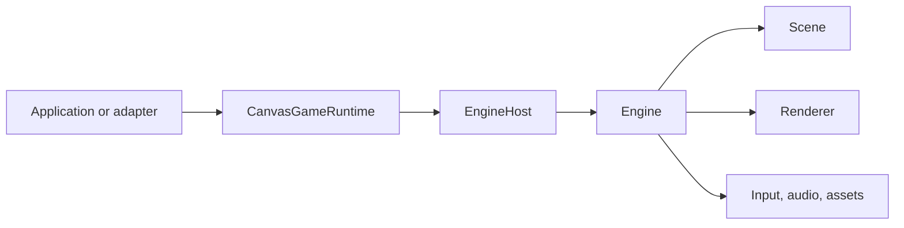

# NIB architecture

NIB is an ES-module runtime surrounded by four consumers: the browser editor, exported games,
framework adapters, and the local MCP bridge. The runtime does not require the editor.

## Repository map

```text
src/        Engine runtime and rendering backends
editor/     Visual editor, project persistence, play mode, and exporters
mcp/        Local stdio server and editor-bridge helpers
adapters/   React, Vue, Svelte, and shared canvas ownership
templates/  Standalone starter projects
examples/   License-cleared runnable examples and classified preset assets
tools/      Build, test, export, boundary, and conversion tooling
docs/       Public documentation
test-*.mjs  Root headless regression suite
```

## Runtime ownership

`SkinnedMeshRenderer` owns its joint texture and releases it on detach/destroy;
reattaching recreates it lazily. Mesh geometry, materials, and asset textures are
borrowed. WebGL2 instance buffers retain unused keys for at most 60 render calls
and trim historical entries above 128 after drawing. A larger current working
set is retained intact. Allocation replacements for PostFX targets, copies,
shadows, and growing instance/foliage buffers publish only after successful
creation; failure cleans partial allocations and preserves the prior generation.

The low-level path is `Engine`: it owns time, input, audio, assets, rendering, and the current `Scene`.
Application entrypoints that need restart or backend recovery should use `CanvasGameRuntime`, which
owns one canvas generation, an `EngineHost`, the current engine/scene, cancellation, and cleanup.



Restart creates a new generation. Stale asynchronous setup is cancelled; the old scene and resources
are disposed before the replacement generation becomes current. Device-bound resources are rebuilt,
not migrated between engines.

## Scene and component model

The editor HDRI coordinator caches one decoded panorama per renderer generation. Changes to
WebGPU HDRI rotation, exposure or IBL enablement coalesce for 32 ms and rebuild derived lighting;
asset changes invalidate the source cache. WebGL keeps its live probe-signature refresh. A new
request or coordinator disposal cancels pending publication while the last complete GPU bundle
remains available. `Engine.syncSkyHdri` accepts an optional `signal`; cancellation is checked
after loading and throughout native WebGPU derivation, including asynchronous SH readback.
Decode work that lacks cancellation support may finish, but cannot publish after cancellation.

`Scene` owns an entity hierarchy. `Entity` owns transform state and components. Components expose
runtime behavior; scripts receive lifecycle calls through the engine loop. Serialization converts
durable project data to runtime objects at a controlled boundary.

Lifecycle calls recheck component ownership, scene membership and active ancestors after
`start` and before subsequent callbacks. Removing, destroying, detaching or disabling a
component or its owner during `start` prevents its update in that step. Reparenting within
the same active scene remains supported. Event emission uses a listener snapshot; a `once`
record is consumed at most once even when another listener emits the same event recursively.

A component instance has one live entity owner. Adding it again to that owner is a no-op;
adding it to another owner throws until it is removed. `onAttach` failure removes that
attachment, runs its `onDestroy` cleanup with the old owner available, and rethrows the
original error. Cleanup runs once per attachment. Reentrant removal is harmless; a newer
attachment created by a callback survives the older callback's return or exception.
Reattachment is supported, including from `onDestroy`, but `start` remains once per instance.
Callbacks must not continue cleaning resources of a new attachment they created themselves.
Use the entity methods to change ownership; direct writes to owner links/arrays are unsupported.

Scene systems have one live scene owner. Repeating `addSystem(system)` on that owner
is a no-op; attaching it to another scene or a destroyed scene throws before insertion.
Each system phase uses a snapshot, so systems added by another system begin on the
next phase. `Scene.destroy()` is terminal and reentrant: components and systems clean
once, the system list detaches before disposal callbacks, and later simulation is inert.
Use fresh system instances for new scenes; public ownership methods, not direct array
or `.scene` writes, define these guarantees. System exceptions remain frame failures.

Low-level `SceneManager` permits one pending `goto`, `back`, `reload`, or `additiveLoad`.
Overlaps reject with `SCENE_BUSY` before invoking another loader, including reentrant calls
from transition events. A failed or cancelled loader leaves current scene/history/cache
unchanged. A scene destroyed by a load observer is rejected before activation.
`opts.signal` and `dispose()` cancel publication with `SCENE_CANCELLED`; the
busy slot remains held until the loader settles. Loaders receive an optional `{signal}`
and should stop their own outstanding I/O and partial allocations when it aborts. A late
unpublished scene is destroyed once. Successful `load()` preloads and activated/returned
scenes remain owned by the caller/engine: `clearCache` and manager disposal only drop
references, and switching does not destroy a previously published scene. A loader should
return a fresh scene unless reusing a scene already published by this manager. A destroyed
cached scene is dropped and rebuilt on the next cached request. Additive load refuses the
destination itself and any active source; it returns
the consumed source; its systems are not transferred and remain the caller's responsibility.
Independent `load()` preloads do not occupy the transition slot. Event callbacks run
synchronously: loader-event failures prevent publication. An Engine refusal before its scene
pointer changes restores manager current/history/cache and discards an unpublished candidate;
this does not undo arbitrary renderer/input/user side effects. Engine/switch observers run
after commit and their exceptions do not roll back the committed transition. Disposal or
abort from a committed callback rejects with `SCENE_CANCELLED`, while the published scene
remains caller-owned; disposal cannot restore cleared manager references. An application
must exclusively coordinate its Engine scene pointer while using the manager.
The editor/export `LevelSession` is a separate owner with its existing `LEVEL_BUSY`, asset
cleanup and departed-caller rules; these low-level changes do not replace that contract.

`Entity.lookAt` accepts a world-space target and up vector. It converts them into parent
coordinates, including invertible nonuniform parent scale. Inherited shear can skew the
other world axes; the entity's own Z scale must be positive for its world -Z to face the
target. A zero-scale parent leaves the rotation unchanged. Chase cameras damp in world
space and convert their result back to local position; 2D follow cameras use the target's
world position and world-space look-ahead. `Camera.getRay` uses the most recently updated
camera matrices: perspective rays start at the camera, orthographic rays at the near plane.

`Vec3.crossVectors(a, b)` accepts output aliasing either or both inputs; `v.cross(v)` is zero.
`Mat4.targetTo` projects arbitrary nonzero up onto the plane perpendicular to its back axis.
Coincident eye/target uses back +Z; zero or parallel up chooses a deterministic perpendicular
cardinal hint (roll is undefined). Finite, representable differences and magnitudes are required;
NaN/infinity are not repaired. The result is an orthonormal right-handed basis suitable for
quaternion decomposition, including non-Y up directions.

## Rendering

For fixed-layout dynamic geometry, mutate attribute data then call
`geometry.updateAttribute(renderer, 'aPosition')`. It refreshes local AABB, origin-centered
radius and CPU revision before uploading the existing WebGL2 buffer; without a renderer it
still refreshes CPU picking/culling, and WebGPU consumes that revision on its next draw.
Attribute sizes and lengths must stay fixed after upload. This does not recompute normals
or resize buffers. Unreported direct data mutations leave caches stale by design.
Terrain keeps its CPU `applyHeights()` bounds path and separate `syncGPU`; GLTFMorph uses
the shared position-update contract on its private mutable geometry.

Production application runtimes use compatibility-gated Auto selection; the low-level synchronous
`Engine` constructor retains its concrete WebGL2 default. The renderer separates 3D, 2D,
post-processing, GPU resource ownership, and backend-independent scene data. WebGPU is selected by a
complete compatible project or an explicit override, and fallback reasons are reported through the
runtime status channel.

Both 3D backends use camera-scoped visibility plans and the same serialized LOD recipe. LOD selection
uses hysteresis and remains local to each camera; main-pass culling does not remove eligible shadow
casters from the shadow pass. Project startup validates component schemas, serialized properties, and
required asset references before committing to WebGPU, then rebuilds on a fresh WebGL2 canvas when a
supported fallback is required.

## Editor boundary

The editor stores projects and assets through dedicated stores, builds runtime scenes from durable
data, and runs play mode as a disposable runtime generation. Undo/redo records editor operations rather
than relying on browser DOM state.

The editor may expose convenience presets, but a preset that depends on an unavailable optional asset
must not appear as a working built-in choice.

## Export boundary

Exporters consume serialized project data and a vendored runtime artifact. Single-HTML export embeds
project assets so opening the file does not fetch absolute developer-machine paths. Standalone project
export writes a web project that is served over HTTP during verification.

## MCP boundary

The stdio MCP server exposes 62 MCP tools. It connects only to the loopback editor bridge, validates
tool payloads, and uses the same project/editor actions as a human workflow. The server is not a remote
administration endpoint and does not bypass editor ownership.

## Verification invariants

- No private workspace state or absolute local paths in the public repository.
- No literal Cyrillic or Russian locale declarations in the English-only public tree.
- No unclassified examples, oversized files, generated outputs, or symlinks.
- Exported projects resolve assets inside their own artifact.
- Documentation counts remain synchronized with 364 headless tests and 62 MCP tools.

The internal WebGPU geometry cache owns geometry-id entries, CPU revision snapshots, and complete
vertex/index buffer bundles. Its restricted host supplies the existing guarded allocation, commit,
and release operations. Same-layout revisions update buffers in place; layout replacements publish
before retiring the previous bundle. Scene detach drains the cache; unused entries expire only after
60 frames. The renderer retains its diagnostic map and facade methods. The frozen module graph
includes this owner; shader text, pipeline exports, and uniform layouts remain independently pinned.

The local development server delegates native watch handles, its 80 ms debounce, 500-event history,
and 25-second long polls to a project-watch owner. It starts after successful HTTP listen. Closing
releases held polls, request listeners, timers, and the native watcher; callbacks from an older
generation cannot publish into a restarted owner. Filesystem mutation, jail, lock, and recovery
transactions remain in their existing modules.

Each Serializer load or clone creates a SceneLoadTransaction. It owns the unpublished scene,
unattached entity subtrees, progress state, and deferred post-load queue. A failed subtree removes
only its deferred work and destroys its attached components. Strict scene/clone failure destroys
the candidate; tolerant loading keeps warning-and-continue behavior. Successful return transfers
the tree to the caller. JSON format, settings patches, and the Serializer facade remain unchanged.
